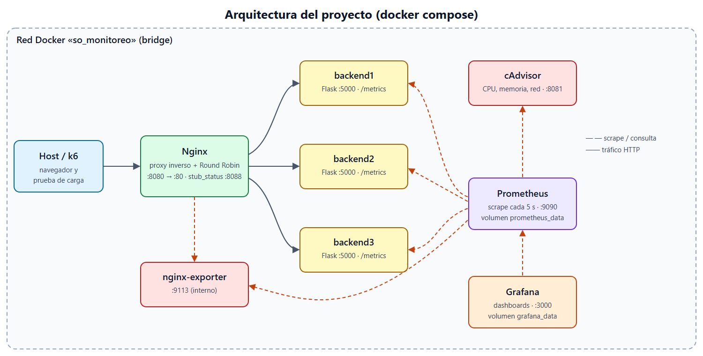

# Proyecto final · Sistemas Operativos (UAO 2026-2)

Infraestructura en contenedores Docker con **Nginx** como proxy inverso y balanceador de carga hacia **tres réplicas de un backend en Flask**, monitoreada con **Prometheus**, **nginx-prometheus-exporter**, **cAdvisor** y **Grafana**.

**Autor:** Juan Camilo Ballesteros Sierra (2230721) · Universidad Autónoma de Occidente · curso 532241, grupo 2.



## Qué hay en el repositorio

```
.
├── docker-compose.yml          # los 8 servicios, la red so_monitoreo y los volúmenes
├── backend/
│   ├── app.py                  # API Flask con /, /api/trabajo, /health y /metrics
│   ├── requirements.txt
│   └── Dockerfile
├── nginx/nginx.conf            # upstream Round Robin + stub_status en :8088 (interno)
├── prometheus/prometheus.yml   # targets: backends, nginx-exporter, cAdvisor, Prometheus
├── grafana/
│   ├── provisioning/           # datasource y proveedor de dashboards (se cargan solos)
│   ├── dashboards/infraestructura.json
│   └── generar_dashboard.py    # genera el JSON del dashboard
├── k6/prueba-carga.js          # prueba de carga (rampa hasta 60 usuarios virtuales)
└── docs/                       # informe, capturas y scripts que las generan
```

## Requisitos previos

- Docker Desktop (o Docker Engine) con **Docker Compose v2**. Recomendado: 4 GB de RAM asignados a Docker.
- Puertos libres en el host: **8080** (Nginx), **8081** (cAdvisor), **9090** (Prometheus) y **3000** (Grafana).
  En Windows, revisa los rangos reservados con `netsh interface ipv4 show excludedportrange protocol=tcp`.
  Si alguno está ocupado, cámbialo con las variables `NGINX_PORT`, `CADVISOR_PORT`, `PROMETHEUS_PORT` o `GRAFANA_PORT` (por ejemplo, en un archivo `.env`).
- Para la prueba de carga: [k6](https://grafana.com/docs/k6/latest/set-up/install-k6/) instalado, o Docker (usa la imagen `grafana/k6`).

## Cómo levantarlo

```bash
git clone https://github.com/ballesterossmartsolutionssas/so-proyecto-final-monitoreo.git
cd so-proyecto-final-monitoreo
docker compose up -d --build
docker compose ps        # los 3 backends deben quedar "healthy"
```

Para apagarlo: `docker compose down` (conserva los datos) o `docker compose down -v` (borra también los volúmenes).

## URLs de acceso

| Servicio | URL | Nota |
|---|---|---|
| Aplicación (a través de Nginx) | http://localhost:8080 | única entrada pública a los backends |
| Operación con CPU | http://localhost:8080/api/trabajo?ms=50 | simula trabajo de 1 a 500 ms |
| Prometheus | http://localhost:9090/targets | los 6 targets deben estar en `UP` |
| Grafana | http://localhost:3000 | abre directo el dashboard; usuario `admin`, clave `admin` (cámbiala con `GRAFANA_ADMIN_PASSWORD`) |
| cAdvisor | http://localhost:8081 | uso de recursos de cada contenedor |

Las métricas de los backends (`:5000/metrics`) y del exportador de Nginx (`:9113`) **no se publican** en el host: Prometheus las lee por la red interna `so_monitoreo`.

## Verificar el balanceo de carga

Cada respuesta dice qué instancia la atendió, y Nginx agrega el encabezado `X-Backend-Instance`:

```powershell
# PowerShell
1..6 | % { curl.exe -s http://localhost:8080/ ; "" }
1..9 | % { (curl.exe -s -D - -o NUL http://localhost:8080/ | Select-String "X-Backend-Instance").Line } | Group-Object | Select Count, Name
```

```bash
# bash
for i in $(seq 9); do curl -s -D - -o /dev/null http://localhost:8080/ | grep -i x-backend-instance; done | sort | uniq -c
```

Con Round Robin, las solicitudes se reparten 1-2-3-1-2-3… (3, 3 y 3 de cada 9).

## Ejecutar la prueba de carga

```bash
k6 run k6/prueba-carga.js
```

Sin instalar k6 (desde la raíz del proyecto, en PowerShell):

```powershell
docker run --rm -e BASE_URL=http://host.docker.internal:8080 -v ${PWD}/k6:/scripts/k6 -w /scripts grafana/k6:1.4.2 run --quiet k6/prueba-carga.js
```

La prueba dura 3 minutos (rampa de 10 a 60 usuarios virtuales), exige menos del 1 % de errores y un p95 menor a 500 ms, y deja el detalle en `k6/resultado.json`. Mientras corre, mira el dashboard de Grafana con refresco cada 5 s.

**Resultado obtenido (22 nov 2026):** 21.584 solicitudes, 119,8 solicitudes/s en promedio, **0 % de errores**, latencia p95 de 74,3 ms y reparto de 34 % / 33 % / 33 % entre los tres backends.

## Métricas principales

| Métrica | Origen | Para qué |
|---|---|---|
| `app_requests_total{instance_id, endpoint, status}` | backend | solicitudes por segundo y reparto del balanceo |
| `app_request_latency_seconds_bucket` | backend | latencia p50/p95/p99 con `histogram_quantile` |
| `app_requests_in_progress` | backend | solicitudes en curso |
| `nginx_http_requests_total`, `nginx_connections_*` | nginx-exporter | tráfico y conexiones de Nginx |
| `container_cpu_usage_seconds_total`, `container_memory_working_set_bytes` | cAdvisor | CPU y memoria de cada contenedor |

El informe completo está en [`docs/Informe_Proyecto_Final_SO_Ballesteros.pdf`](docs/Informe_Proyecto_Final_SO_Ballesteros.pdf).
