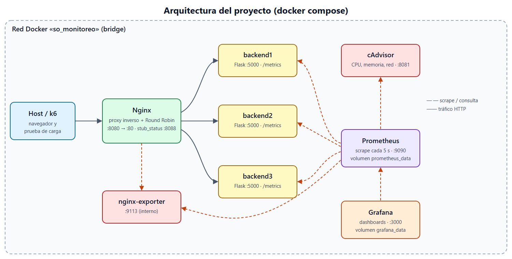
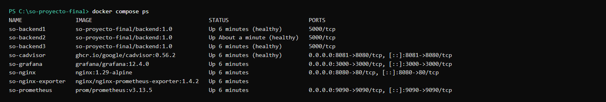
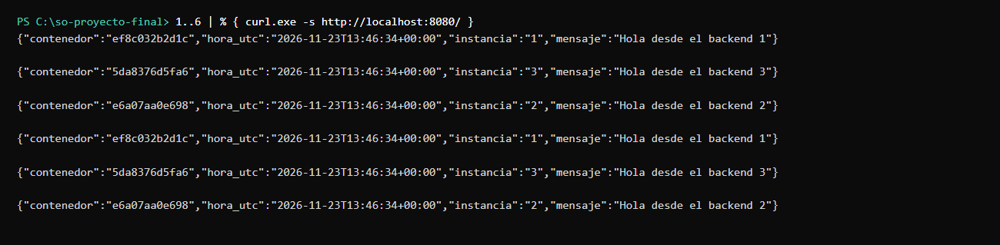
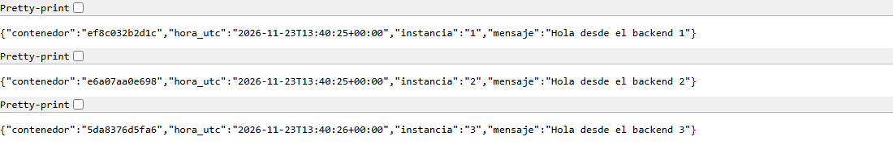
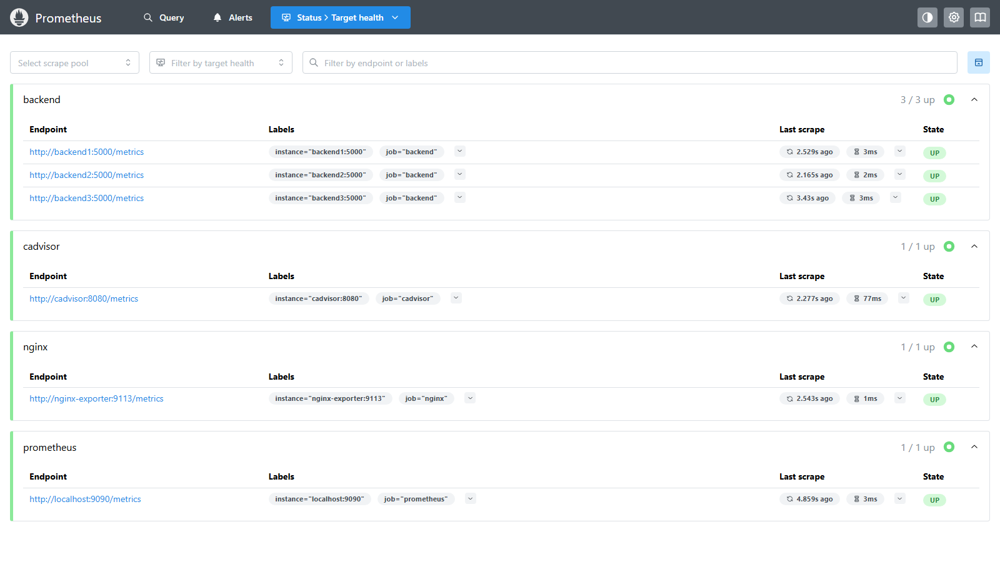
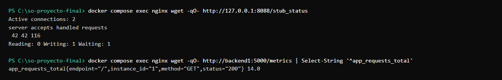
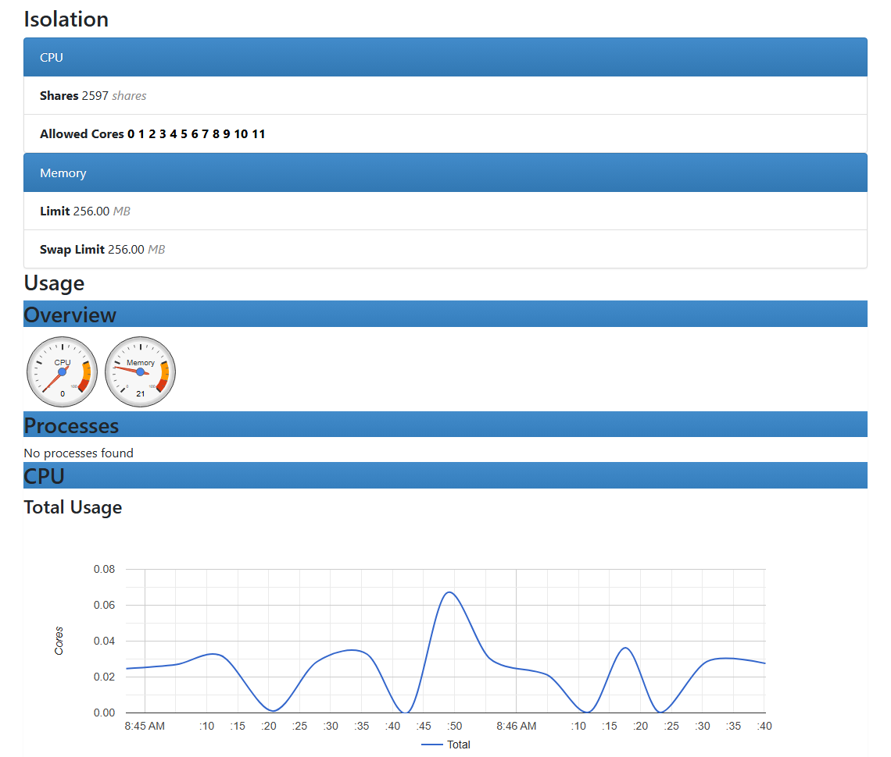
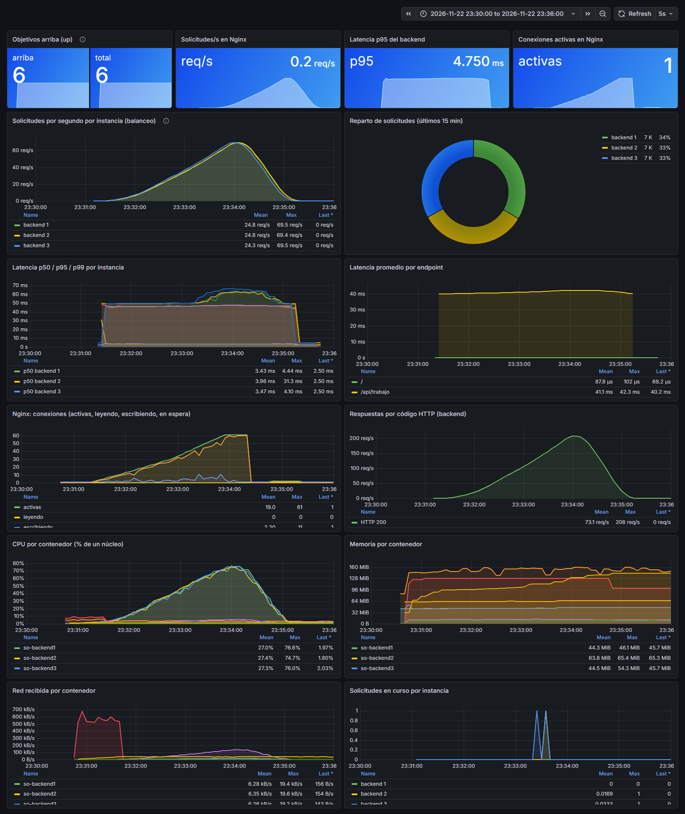
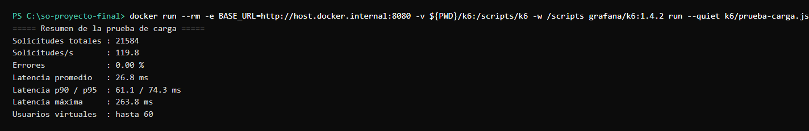
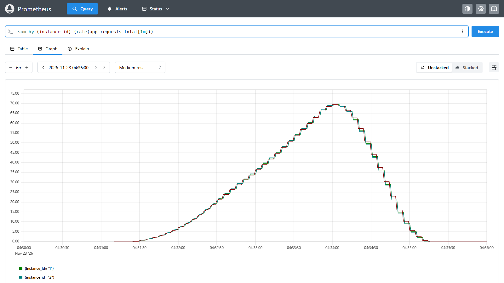

titulo: Proyecto final — Infraestructura en contenedores con balanceo de carga y monitoreo
subtitulo: Nginx · 3 backends Flask · Prometheus · nginx-prometheus-exporter · cAdvisor · Grafana · k6
curso: Sistemas Operativos (532241) — Grupo 2
autores: Juan Camilo Ballesteros Sierra - 2230721
fecha: 23 de noviembre de 2026
pie: Proyecto final Sistemas Operativos — Ballesteros
portada: si
---
# 1. Introducción

Una de las tareas de un administrador de sistemas operativos es preparar entornos donde las aplicaciones se puedan desplegar, probar y vigilar. En este proyecto se construyó, con Docker y Docker Compose, una infraestructura completa que reproduce un escenario real: un servidor **Nginx** recibe todo el tráfico y lo reparte entre **tres réplicas de un backend**, y un sistema de monitoreo (**Prometheus**, **nginx-prometheus-exporter**, **cAdvisor** y **Grafana**) mide en todo momento el tráfico, la latencia y el consumo de recursos de cada contenedor. Al final se sometió la infraestructura a una **prueba de carga con k6** y se analizó su comportamiento en los dashboards.

**Repositorio:** https://github.com/ballesterossmartsolutionssas/so-proyecto-final-monitoreo (código fuente, README.md y este informe).

**Objetivos:**
- Levantar con un solo comando (`docker compose up`) ocho servicios conectados por una red Docker propia.
- Configurar Nginx como proxy inverso y balanceador de carga, y comprobar que el reparto es equitativo.
- Instrumentar el backend para que exponga métricas en formato Prometheus (`/metrics`).
- Recolectar métricas de Nginx, de los backends y de los contenedores, y visualizarlas en Grafana.
- Medir el desempeño con una prueba de carga desde la máquina física y documentar los resultados.

# 2. Configuración del entorno

| Elemento | Versión o valor |
|---|---|
| Sistema operativo del host | Windows 11 Pro (64 bits) |
| Motor de contenedores | Docker Desktop, Docker Engine 29.9.3 (backend WSL 2) |
| Orquestación | Docker Compose v5.7.0 |
| Recursos asignados a Docker | 12 CPU lógicas y 11,5 GB de RAM |
| Herramienta de carga | k6 1.4.2 (imagen `grafana/k6`, ejecutada desde el host) |

Antes de empezar se verificó que Docker y Compose respondieran (`docker info`, `docker compose version`) y que los puertos 8080, 8081, 9090 y 3000 no estuvieran dentro de los rangos que Windows reserva para Hyper-V y WSL (`netsh interface ipv4 show excludedportrange protocol=tcp`). Ninguno estaba reservado.

# 3. Arquitectura de la infraestructura



El usuario (o la prueba de carga) solo conoce una dirección: `http://localhost:8080`, publicada por Nginx. Nginx reenvía cada solicitud a uno de los tres backends por la red interna. En paralelo, Prometheus consulta cada 5 segundos las métricas de los backends, del exportador de Nginx y de cAdvisor, y Grafana dibuja esas series en un dashboard.

| Servicio | Imagen | Puerto en el host | Función |
|---|---|---|---|
| backend1, backend2, backend3 | `so-proyecto-final/backend:1.0` (propia) | ninguno (5000 interno) | API Flask; cada réplica se identifica con `INSTANCE_ID` y expone `/metrics` |
| nginx | `nginx:1.29-alpine` | 8080 → 80 | proxy inverso y balanceo Round Robin; `stub_status` en 8088 (interno) |
| nginx-exporter | `nginx/nginx-prometheus-exporter:1.4.2` | ninguno (9113 interno) | traduce `stub_status` al formato de Prometheus |
| cadvisor | `ghcr.io/google/cadvisor:0.56.2` | 8081 → 8080 | CPU, memoria, red y disco de cada contenedor |
| prometheus | `prom/prometheus:v3.13.5` | 9090 | recolecta y guarda las series de tiempo |
| grafana | `grafana/grafana:12.4.0` | 3000 | dashboards |

**Decisiones de diseño:**
- **Una sola puerta de entrada.** Los backends no publican puertos: solo se llega a ellos a través de Nginx. Lo mismo pasa con las métricas internas (`:5000/metrics`, `:8088/stub_status`, `:9113`), que solo Prometheus puede leer por la red `so_monitoreo`.
- **Red personalizada.** La red bridge `so_monitoreo` le da a cada servicio un nombre DNS (`backend1`, `nginx`, `prometheus`…), así que las configuraciones usan nombres y no direcciones IP.
- **Persistencia.** Prometheus y Grafana guardan sus datos en volúmenes con nombre (`prometheus_data`, `grafana_data`). Por eso, al reiniciar el equipo al día siguiente, las métricas de la prueba de carga seguían disponibles para las capturas de este informe.



# 4. El archivo docker-compose.yml

El archivo completo está en el repositorio. Sus partes principales:

```yaml
name: so-proyecto-final

x-backend: &backend            # bloque reutilizable para las 3 réplicas
  build: ./backend
  image: so-proyecto-final/backend:1.0
  restart: unless-stopped
  networks: [monitoreo]
  deploy:
    resources:
      limits: { cpus: "1.0", memory: 256M }

services:
  backend1:
    <<: *backend
    container_name: so-backend1
    environment: { INSTANCE_ID: "1" }
  # backend2 y backend3 son iguales, con INSTANCE_ID 2 y 3

  nginx:
    image: nginx:1.29-alpine
    ports: ["${NGINX_PORT:-8080}:80"]
    volumes: ["./nginx/nginx.conf:/etc/nginx/nginx.conf:ro"]
    depends_on:
      backend1: { condition: service_healthy }
      backend2: { condition: service_healthy }
      backend3: { condition: service_healthy }

  nginx-exporter:
    image: nginx/nginx-prometheus-exporter:1.4.2
    command: ["--nginx.scrape-uri=http://nginx:8088/stub_status"]

  cadvisor:
    image: ghcr.io/google/cadvisor:0.56.2
    privileged: true
    command: ["--housekeeping_interval=5s", "--docker_only=true"]
    volumes: ["/:/rootfs:ro", "/var/run:/var/run:ro", "/sys:/sys:ro",
              "/var/lib/docker/:/var/lib/docker:ro"]

  prometheus:
    image: prom/prometheus:v3.13.5
    command: ["--config.file=/etc/prometheus/prometheus.yml",
              "--storage.tsdb.retention.time=7d"]
    volumes: ["./prometheus/prometheus.yml:/etc/prometheus/prometheus.yml:ro",
              "prometheus_data:/prometheus"]

  grafana:
    image: grafana/grafana:12.4.0
    volumes: ["./grafana/provisioning:/etc/grafana/provisioning:ro",
              "./grafana/dashboards:/var/lib/grafana/dashboards:ro",
              "grafana_data:/var/lib/grafana"]

networks:
  monitoreo: { name: so_monitoreo, driver: bridge }
volumes:
  prometheus_data:
  grafana_data:
```

- **Ancla YAML.** El bloque `x-backend` se define una vez y cada réplica lo hereda con la clave de fusión `<<:`. Las tres réplicas comparten la misma definición; solo cambia `INSTANCE_ID`. Si se necesita una cuarta réplica, basta con copiar cuatro líneas.
- **Límites de recursos.** Cada backend tiene como máximo 1 CPU y 256 MB de RAM. Así se puede ver en cAdvisor cuándo un contenedor se acerca a su límite.
- **depends_on con service_healthy.** Nginx no arranca hasta que los tres backends pasan su verificación de salud. Así se evita que las primeras solicitudes reciban un 502.
- **Nombres con prefijo so-.** En el equipo quedaban contenedores de laboratorios anteriores con nombres como `prometheus`, que chocaban con este proyecto. El prefijo evita el conflicto sin borrar nada ajeno.
- **Puertos configurables.** Todos los puertos publicados se pueden cambiar con variables (`NGINX_PORT`, `GRAFANA_PORT`, etc.) por si en otro equipo alguno está ocupado.

# 5. El backend y su Dockerfile

El backend es una API mínima en **Python 3.12 con Flask**, servida con **Gunicorn**. Tiene cuatro rutas:

| Ruta | Qué hace |
|---|---|
| `GET /` | responde un JSON con el número de instancia, el nombre del contenedor y la hora |
| `GET /api/trabajo?ms=50` | simula una operación que usa CPU durante los milisegundos indicados (1 a 500), calculando hashes SHA-256 |
| `GET /health` | verificación de salud que usan Docker y el `HEALTHCHECK` |
| `GET /metrics` | métricas en formato Prometheus (librería oficial `prometheus_client`) |

Además, cada respuesta lleva el encabezado `X-Instance-Id`, que Nginx reenvía al cliente como `X-Backend-Instance` para ver el balanceo.

**Métricas que expone el backend** (se registran en los hooks `before_request` y `after_request` de Flask, sin contar `/metrics` ni `/health` para no ensuciar los datos):

```python
REQUESTS = Counter("app_requests_total", "Solicitudes HTTP atendidas por el backend",
                   ["instance_id", "method", "endpoint", "status"])
LATENCY = Histogram("app_request_latency_seconds", "Tiempo que tarda el backend en responder",
                    ["instance_id", "endpoint"],
                    buckets=(0.005, 0.01, 0.025, 0.05, 0.075, 0.1, 0.25, 0.5, 1.0, 2.5))
IN_PROGRESS = Gauge("app_requests_in_progress", "Solicitudes en curso", ["instance_id"])
```

**Dockerfile:**

```dockerfile
FROM python:3.12-slim
ENV PYTHONDONTWRITEBYTECODE=1 PYTHONUNBUFFERED=1
WORKDIR /app
COPY requirements.txt .
RUN pip install --no-cache-dir -r requirements.txt
COPY app.py .
RUN useradd --create-home --uid 10001 appuser
USER appuser
EXPOSE 5000
HEALTHCHECK --interval=10s --timeout=3s --start-period=5s --retries=3 \
  CMD python -c "import urllib.request; urllib.request.urlopen('http://127.0.0.1:5000/health', timeout=2)"
CMD ["gunicorn", "-w", "1", "--threads", "8", "-b", "0.0.0.0:5000", "--access-logfile", "-", "app:app"]
```

- **Imagen base python:3.12-slim.** Es pequeña y trae glibc, así que las ruedas de pip se instalan sin compilar.
- **Orden de las capas.** Primero se copia `requirements.txt` y se instalan las dependencias; después, el código. Mientras no cambien las dependencias, Docker reutiliza esa capa y reconstruir tarda segundos.
- **Usuario sin privilegios.** El proceso corre como `appuser` (UID 10001), no como root, y eso reduce el impacto si la aplicación fuera comprometida.
- **HEALTHCHECK.** Docker marca el contenedor como «healthy» solo si `/health` responde; de ese estado depende el arranque de Nginx.
- **Un proceso con 8 hilos (-w 1 --threads 8).** Con varios procesos de Gunicorn, cada uno tendría sus propios contadores de Prometheus y cada consulta leería uno distinto, con cifras que saltan. Con un solo proceso y 8 hilos la capacidad de atención concurrente se mantiene y las métricas son coherentes.

# 6. Configuración de Nginx como proxy inverso

```nginx
upstream backend {
    zone backend 64k;                         # estado compartido entre workers
    server backend1:5000 max_fails=3 fail_timeout=10s;
    server backend2:5000 max_fails=3 fail_timeout=10s;
    server backend3:5000 max_fails=3 fail_timeout=10s;
    keepalive 32;                             # conexiones reutilizables a los backends
}
server {
    listen 80;
    add_header X-Upstream $upstream_addr always;
    add_header X-Backend-Instance $upstream_http_x_instance_id always;
    location / {
        proxy_pass http://backend;
        proxy_http_version 1.1;
        proxy_set_header Connection "";
        proxy_set_header Host $host;
        proxy_set_header X-Real-IP $remote_addr;
        proxy_set_header X-Forwarded-For $proxy_add_x_forwarded_for;
        proxy_next_upstream error timeout http_502 http_503;
    }
    location = /metrics { return 404; }       # no exponer métricas al exterior
}
server {
    listen 8088;                              # puerto interno, no publicado
    location = /stub_status { stub_status; }
}
```

- **Algoritmo Round Robin** (el predeterminado de Nginx): cada solicitud va al siguiente servidor de la lista. Es adecuado porque las tres réplicas son idénticas.
- **zone backend 64k.** Sin esta directiva, cada proceso *worker* de Nginx lleva su propio turno del Round Robin y, con pocas solicitudes, el reparto se ve desigual. Con la zona, todos los workers comparten el mismo estado. Este problema ya había aparecido en el laboratorio de proxy inverso.
- **Tolerancia a fallos.** `max_fails` y `fail_timeout` sacan de la rotación durante 10 s a un backend que falla tres veces seguidas, y `proxy_next_upstream` reintenta la solicitud en otro backend.
- **keepalive 32 con HTTP/1.1.** Nginx reutiliza las conexiones hacia los backends en lugar de abrir una nueva por cada solicitud, lo que reduce la latencia bajo carga.
- **Encabezados X-Real-IP y X-Forwarded-For.** Le pasan al backend la IP real del cliente.
- **stub_status en un puerto aparte (8088).** Lo lee el exportador; como el puerto no se publica en el compose, nadie desde fuera puede consultarlo.

**Verificación del balanceo.** Seis solicitudes seguidas a `http://localhost:8080/` fueron atendidas en orden por los backends 1, 2, 3, 1, 2, 3. Al contar el encabezado `X-Backend-Instance` en nueve solicitudes, cada instancia atendió exactamente tres.





**Prueba de tolerancia a fallos.** Con `docker compose stop backend2` se apagó una réplica y se enviaron nueve solicitudes: las **nueve respondieron HTTP 200**, cuatro atendidas por el backend 1 y cinco por el backend 3. Nginx detectó la falla y dejó de enviar tráfico al backend caído. Después de `docker compose start backend2` y de que el contenedor volvió a estar «healthy», otras nueve solicitudes se repartieron otra vez 3, 3 y 3.

```text
docker compose stop backend2   →  9 solicitudes: 4 × backend 1, 5 × backend 3, todas HTTP 200
docker compose start backend2  →  9 solicitudes: 3 × backend 1, 3 × backend 2, 3 × backend 3
```

# 7. Monitoreo: métricas recolectadas

## 7.1 Prometheus

```yaml
global:
  scrape_interval: 5s
scrape_configs:
  - job_name: prometheus
    static_configs: [{ targets: ["localhost:9090"] }]
  - job_name: backend
    static_configs: [{ targets: ["backend1:5000", "backend2:5000", "backend3:5000"] }]
  - job_name: nginx
    static_configs: [{ targets: ["nginx-exporter:9113"] }]
  - job_name: cadvisor
    static_configs: [{ targets: ["cadvisor:8080"] }]
```

Prometheus consulta los seis objetivos cada 5 segundos. Todos aparecen en estado **UP**:



## 7.2 Nginx Prometheus Exporter y cAdvisor

El exportador lee `http://nginx:8088/stub_status` y lo convierte en métricas como `nginx_http_requests_total` (solicitudes acumuladas) y `nginx_connections_active`, `_reading`, `_writing` y `_waiting`. cAdvisor monta en modo de solo lectura las carpetas del sistema (`/sys`, `/var/lib/docker`, etc.) para leer los *cgroups* del kernel de Linux. De ahí salen el uso de CPU, la memoria, la red y el disco de cada contenedor. Es el mismo mecanismo que usa el sistema operativo para limitar los recursos de un contenedor.



{11}

## 7.3 Métricas monitoreadas

| Métrica | Fuente | Consulta PromQL usada en Grafana | Qué muestra |
|---|---|---|---|
| Solicitudes/s por instancia | backend | `sum by (instance_id) (rate(app_requests_total[1m]))` | si el balanceo es parejo |
| Reparto de solicitudes | backend | `sum by (instance_id) (increase(app_requests_total[15m]))` | porcentaje atendido por cada réplica |
| Latencia p50/p95/p99 | backend | `histogram_quantile(0.95, sum by (le, instance_id) (rate(app_request_latency_seconds_bucket[1m])))` | tiempo de respuesta del backend |
| Latencia promedio por endpoint | backend | `rate(..._sum[1m]) / rate(..._count[1m])` | diferencia entre `/` y `/api/trabajo` |
| Respuestas por código HTTP | backend | `sum by (status) (rate(app_requests_total[1m]))` | errores 4xx o 5xx |
| Solicitudes/s en Nginx | exporter | `sum(rate(nginx_http_requests_total[1m]))` | tráfico total de entrada |
| Conexiones de Nginx | exporter | `nginx_connections_active`, `_reading`, `_writing`, `_waiting` | concurrencia |
| CPU por contenedor | cAdvisor | `sum by (name) (rate(container_cpu_usage_seconds_total{name=~"so-.+"}[1m])) * 100` | % de un núcleo |
| Memoria por contenedor | cAdvisor | `sum by (name) (container_memory_working_set_bytes{name=~"so-.+"})` | memoria en uso |
| Red recibida | cAdvisor | `sum by (name) (rate(container_network_receive_bytes_total{...}[1m]))` | bytes/s |
| Objetivos activos | Prometheus | `sum(up)` y `count(up)` | salud del monitoreo |

## 7.4 Dashboard de Grafana

Grafana se configura sola al arrancar gracias al **provisioning**. El archivo `provisioning/datasources/prometheus.yml` crea la fuente de datos (`http://prometheus:9090`), y `provisioning/dashboards/dashboards.yml` carga el dashboard `dashboards/infraestructura.json`, que además queda como página de inicio. El JSON se genera con `grafana/generar_dashboard.py`, para no editar a mano cientos de líneas. El dashboard «Proyecto final SO — Infraestructura Docker» tiene 14 paneles, organizados en filas:

1. **Indicadores rápidos:** objetivos activos, solicitudes/s en Nginx, latencia p95 y conexiones activas.
2. **Balanceo:** solicitudes por segundo de cada instancia y gráfico de anillo con el reparto.
3. **Latencia:** percentiles p50, p95 y p99 por instancia y latencia promedio por endpoint.
4. **Nginx y errores:** estados de las conexiones y respuestas por código HTTP.
5. **Recursos (cAdvisor):** CPU, memoria, red y solicitudes en curso por contenedor.



# 8. Pruebas de carga

## 8.1 Diseño de la prueba

La prueba se hizo con **k6** desde la máquina física: el contenedor de k6 no pertenece a la red del proyecto y llega a Nginx por el puerto publicado del host (`host.docker.internal:8080`), igual que un navegador. El script `k6/prueba-carga.js` define:

- **Etapas:** 30 s subiendo a 10 usuarios virtuales (VU), 1 min hasta 30 VU, 1 min hasta 60 VU y 30 s de bajada. En total, 3 minutos.
- **Mezcla de solicitudes:** 70 % a `/` (respuesta inmediata) y 30 % a `/api/trabajo?ms=40` (40 ms de CPU), con una pausa de 0,2 s por usuario entre solicitudes.
- **Umbrales de aceptación:** menos del 1 % de errores (`http_req_failed`) y p95 menor a 500 ms (`http_req_duration`).
- **Validaciones:** cada respuesta debe ser HTTP 200 y traer el encabezado `X-Backend-Instance`.

```powershell
docker run --rm -e BASE_URL=http://host.docker.internal:8080 -v ${PWD}/k6:/scripts/k6 `
  -w /scripts grafana/k6:1.4.2 run --quiet k6/prueba-carga.js
```

## 8.2 Resultados



| Indicador | Resultado | Umbral |
|---|---|---|
| Solicitudes totales | 21.584 | — |
| Solicitudes por segundo (promedio) | 119,8 | — |
| Pico de solicitudes/s en Nginx (Prometheus) | 206,9 | — |
| Errores | **0,00 %** (21.584 de 21.584 con HTTP 200) | < 1 % ✔ |
| Latencia promedio (vista por k6) | 26,8 ms | — |
| Latencia p90 / p95 (vista por k6) | 61,1 / **74,3 ms** | p95 < 500 ms ✔ |
| Latencia máxima | 263,8 ms | — |
| Usuarios virtuales | hasta 60 | — |

**Reparto entre instancias (Prometheus, increase en la ventana de la prueba):**

| Instancia | Solicitudes | Porcentaje | p95 máximo del backend | CPU máxima | Memoria máxima |
|---|---|---|---|---|---|
| backend 1 | 7.375 | 33,9 % | 47,3 ms | 76,6 % de un núcleo | 46 MB |
| backend 2 | 7.357 | 33,8 % | 47,0 ms | 74,7 % de un núcleo | 65 MB |
| backend 3 | 7.222 | 33,2 % | 47,5 ms | 75,2 % de un núcleo | 54 MB |



## 8.3 Análisis

- **El balanceo funciona.** Las tres réplicas atendieron entre el 33,2 % y el 33,9 % de las solicitudes y sus curvas de solicitudes/s se superponen. La pequeña diferencia se explica porque k6 elige al azar entre `/` y `/api/trabajo`, que no cuestan lo mismo.
- **La infraestructura aguantó sin errores** el pico de 60 usuarios: 0 % de fallas y un p95 de 74 ms, muy por debajo del umbral de 500 ms.
- **Dónde está el tiempo.** El p95 medido por el backend (unos 47 ms) corresponde casi entero a los 40 ms de trabajo de `/api/trabajo`. La diferencia con lo que ve k6 (74 ms) es el camino desde el host: la red virtual de Docker Desktop (WSL 2), el proxy de Nginx y la cola de conexiones cuando hay 60 usuarios a la vez. Eso coincide con el panel de Nginx, donde las conexiones activas suben hasta 61 en el pico.
- **Recursos.** En el pico, cada backend usó cerca del 75 % del núcleo que tiene asignado, y la memoria se mantuvo por debajo de 70 MB de los 256 MB permitidos. Nginx apenas pasó del 5 % de CPU. El primer recurso en agotarse sería la CPU de los backends, así que para soportar más carga conviene **agregar réplicas** (escalar horizontalmente) antes que darle más memoria a cada una.
- **Costo del monitoreo.** Prometheus, Grafana, cAdvisor y el exportador sumaron unos 450 MB de memoria y, en el pico, cerca del 16 % de un núcleo: un costo bajo comparado con la visibilidad que dan.

# 9. Problemas encontrados y cómo se resolvieron

| Problema | Causa | Solución |
|---|---|---|
| `Conflict. The container name "/prometheus" is already in use` | contenedores detenidos de laboratorios anteriores usaban los mismos nombres | prefijo `so-` en `container_name` (no se borró nada ajeno al proyecto) |
| Reparto desigual del Round Robin con pocas solicitudes | cada worker de Nginx llevaba su propio turno | directiva `zone backend 64k` en el `upstream` |
| Contadores de Prometheus que «saltaban» | varios procesos de Gunicorn con contadores separados | Gunicorn con 1 proceso y 8 hilos |
| Captura de Prometheus con targets «UNKNOWN» | la página se abrió segundos después de reiniciar el stack | esperar el primer scrape (5 s) antes de verificar |
| Puertos que Windows puede reservar (Hyper-V/WSL) | rangos dinámicos de exclusión | verificación con `netsh` y puertos configurables por variables |

# 10. Conclusiones

- Docker Compose permite describir en un solo archivo una infraestructura de ocho servicios, con su red, sus volúmenes, sus dependencias y sus límites de recursos, y levantarla igual en cualquier equipo con un comando. Eso es justamente lo que necesita un administrador para crear entornos de desarrollo y pruebas reproducibles.
- Nginx como proxy inverso centraliza la entrada, oculta los backends y reparte la carga. Con `zone`, `keepalive` y reintentos, el reparto quedó en 33/33/33 % y, como se comprobó apagando el backend 2, el servicio sigue respondiendo cuando cae una réplica.
- El monitoreo cambia la forma de administrar: en lugar de suponer, los dashboards mostraron que el cuello de botella bajo carga es la CPU de los backends y no la memoria ni Nginx. Ese dato orienta la decisión de escalar.
- cAdvisor deja ver un concepto central del curso: los contenedores son procesos del sistema operativo aislados con *namespaces* y limitados con *cgroups*. Los límites de 1 CPU y 256 MB definidos en el compose aparecen en cAdvisor tal como los aplica el kernel.

# 11. Cómo reproducir el proyecto

El `README.md` del repositorio explica los requisitos previos, cómo levantar la infraestructura (`docker compose up -d --build`), las URLs de acceso (Nginx en `:8080`, Prometheus en `:9090`, Grafana en `:3000`, cAdvisor en `:8081`), cómo verificar el balanceo y cómo ejecutar la prueba de carga.

**Repositorio:** https://github.com/ballesterossmartsolutionssas/so-proyecto-final-monitoreo

# Referencias

[[ref]] Docker Inc. (2026). *Compose file reference*. https://docs.docker.com/reference/compose-file/
[[ref]] Docker Inc. (2026). *Dockerfile reference*. https://docs.docker.com/reference/dockerfile/
[[ref]] F5 NGINX. (2026). *Module ngx_http_upstream_module*. https://nginx.org/en/docs/http/ngx_http_upstream_module.html
[[ref]] F5 NGINX. (2026). *Module ngx_http_stub_status_module*. https://nginx.org/en/docs/http/ngx_http_stub_status_module.html
[[ref]] NGINX Inc. (2026). *NGINX Prometheus Exporter*. https://github.com/nginx/nginx-prometheus-exporter
[[ref]] Prometheus Authors. (2026). *Prometheus documentation: Configuration y Querying basics*. https://prometheus.io/docs/
[[ref]] Prometheus Authors. (2026). *prometheus_client (Python)*. https://prometheus.github.io/client_python/
[[ref]] Google. (2026). *cAdvisor (Container Advisor)*. https://github.com/google/cadvisor
[[ref]] Grafana Labs. (2026). *Provision Grafana*. https://grafana.com/docs/grafana/latest/administration/provisioning/
[[ref]] Grafana Labs. (2026). *k6 documentation*. https://grafana.com/docs/k6/latest/
